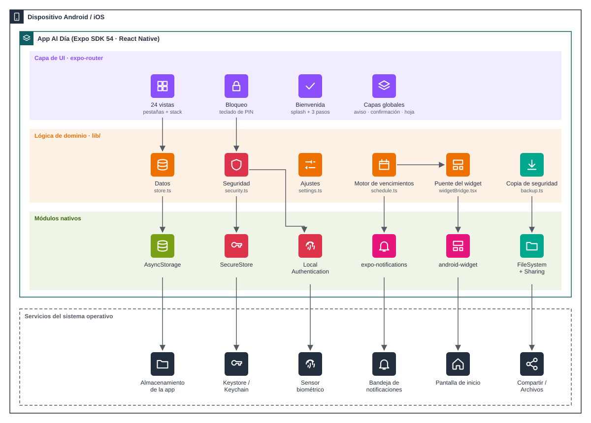
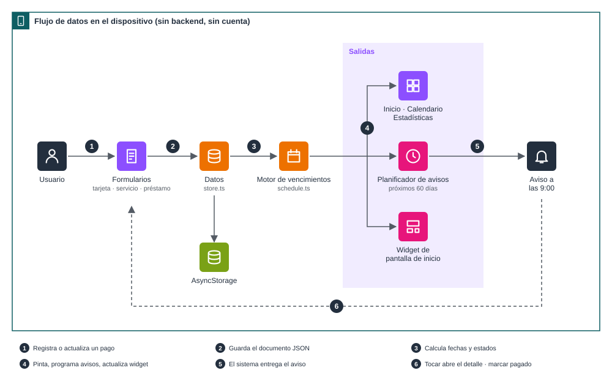

<p align="center">
  
</p>

<h1 align="center">Al Día</h1>

<p align="center">Recordatorios de vencimientos de tarjetas, servicios, suscripciones y préstamos en Perú.<br/>
Datos solo en el celular, sin cuenta, con bloqueo por PIN o huella.</p>

<p align="center"><a href="README.md">English</a> · <b>Español</b></p>

---

## Resumen

| Área | Alcance |
|---|---|
| Productos | Tarjetas de crédito, servicios (luz, agua, gas, internet, telefonía, cable, otros), suscripciones, membresías, préstamos |
| Tarjetas | Total y mínimo del estado de cuenta, interés por pago mínimo según TEA, avance de exoneración de membresía por ciclo |
| Vistas | Inicio, Productos, Calendario, Estadísticas, Ajustes, Recordatorios, detalles y formularios (24 en total) |
| Avisos | Notificaciones locales N días antes (1, 2, 3, 5 o 7) y el día de vencimiento a las 09:00; suscripciones 1 día antes |
| Pagos | Pulsación larga en una fila de Inicio, Calendario o Recordatorios para registrar el pago; se pide el monto real en tarjetas sin estado de cuenta y recibos variables; se puede deshacer desde el aviso |
| Seguridad | PIN de 4 dígitos (SHA-256 con sal en SecureStore) y biometría; nuevo bloqueo tras 30 s en segundo plano; tras 5 intentos fallidos, esperas de 30 s que se duplican con cada fallo; opción para ocultar el contenido en apps recientes (en Android también bloquea capturas) |
| Copia de seguridad | Exportación e importación manual en JSON; cada registro importado se valida campo por campo |
| Widget | Widget Android 4×2 con los 3 próximos pagos abiertos y el total pendiente del mes, en versión clara y oscura |
| Listas | Búsqueda y orden (fecha, monto, nombre) en tarjetas, servicios y suscripciones desde 4 elementos; los formularios preguntan antes de descartar cambios |
| Plataformas | Android (principal), iOS |
| Moneda | Soles (S/) o dólares (US$), solo de visualización |

## Arquitectura



| Capa | Ubicación | Responsabilidad |
|---|---|---|
| UI | `app/`, `components/` | Vistas de expo-router, barra de pestañas flotante, capas globales (aviso, confirmación, hoja de opciones), bloqueo, bienvenida |
| Lógica de dominio | `lib/` | Stores sobre AsyncStorage, motor de vencimientos, planificador de avisos, seguridad, copia de seguridad, puente del widget |
| Módulos nativos | Expo SDK 54 | AsyncStorage, SecureStore, LocalAuthentication, expo-notifications, react-native-android-widget, FileSystem y Sharing |
| Servicios del sistema | Android / iOS | Almacenamiento de la app, Keystore/Keychain, sensor biométrico, bandeja de notificaciones, pantalla de inicio, compartir |

Todos los stores siguen un mismo patrón: estado en memoria, conjunto de oyentes, hook con `useSyncExternalStore` y copia JSON en AsyncStorage. Los estilos van en línea y toman los tokens de `lib/theme.ts`.

## Flujo de datos



Las fechas de vencimiento no se guardan. `lib/schedule.ts` las calcula en cada render a partir de la regla de cada producto (día de pago, periodicidad, cuotas) y de los pagos registrados.

| Estado | Regla |
|---|---|
| Vencido | Fecha anterior a hoy y sin pago registrado |
| Por vencer | Fecha de hoy o posterior y sin pago registrado |
| Pagado | Pago registrado para esa fecha; las suscripciones cuentan como pagadas al pasar la fecha |
| Tarjeta sin estado de cuenta | Las fechas pasadas sin estado de cuenta ni pago se ignoran (el monto adeudado es desconocido) |
| Exoneración | Consumo acumulado hasta el siguiente cierre frente al consumo mínimo de la tarjeta |

Los avisos se reconstruyen 800 ms después de cualquier cambio de datos o ajustes y cada vez que la app vuelve a primer plano: se cancelan todos y se programan de nuevo los de los próximos 60 días (máximo 60 avisos).

## Requisitos

| Herramienta | Versión |
|---|---|
| Node.js | 22 o superior |
| pnpm | 11.5.2 (campo `packageManager`) |
| Expo SDK | 54 |
| EAS CLI | Incluido como dependencia de desarrollo (`pnpm exec eas`); requiere `eas login` y `eas init` una vez |
| Dispositivo o emulador Android | Android 7 (API 24) o superior |

## Inicio rápido

```bash
pnpm install
pnpm start          # servidor de desarrollo de Expo
```

| Entorno | Funciones disponibles |
|---|---|
| Expo Go | Todas excepto el widget de pantalla de inicio |
| Build de desarrollo | Todas, incluido el widget |

## Scripts

| Script | Comando | Resultado |
|---|---|---|
| `start` | `expo start` | Servidor de desarrollo |
| `android` / `ios` | `expo run:<plataforma>` | Compilación nativa local y ejecución |
| `typecheck` | `tsc --noEmit` | Revisión de TypeScript |
| `doctor` | `npx expo-doctor` | Revisión de dependencias y configuración |
| `build:dev` | `eas build --profile development --platform android --no-wait` | APK con dev client (nube) |
| `build:dev:ios` | `eas build --profile development --platform ios --no-wait` | Dev client para iOS (nube) |
| `build:dev:local` | igual que `build:dev` con `--local` | APK con dev client (máquina local) |
| `build:preview` | `eas build --profile preview --platform android --no-wait` | APK instalable de release (nube) |
| `build:preview:local` | igual que `build:preview` con `--local` | APK instalable de release (máquina local) |
| `build:prod` | `eas build --profile production --platform android --no-wait` | Build de tienda (AAB), versionCode autoincremental |
| `docs:diagrams` | `node docs/architecture/build-diagrams.js` | Regenera los diagramas SVG en EN y ES |

## Perfiles de compilación

| Perfil | Distribución | Artefacto Android | Uso |
|---|---|---|---|
| development | interna | APK con dev client | Desarrollo diario con `pnpm start` |
| preview | interna | APK | Pruebas en equipos reales sin servidor de desarrollo |
| production | tienda | AAB | Google Play |

Las compilaciones locales (`--local`) requieren el Android SDK y JDK 17.

## Estructura del proyecto

```
app/                    rutas de expo-router
  (tabs)/               Inicio, Productos (stack anidado), Calendario, Estadísticas, Ajustes
  card/ service/        detalle [id], formulario, estado de cuenta (tarjetas)
  subscription/ loan/   detalle [id], formulario
  reminders.tsx pin.tsx
components/             ui.tsx (kit de diseño), Icon, Logo, AppTabBar, Hosts, PinPad, LockScreen, Welcome
lib/                    store, settings, schedule, notifications, security, backup, widgetBridge, dates, format, theme
widget/                 UI del widget Android y tarea en segundo plano
docs/design/            Diseños de origen de las vistas
docs/architecture/      Diagramas y su generador
assets/                 Íconos y splash generados desde el logo del diseño
```

## Modelo de datos

| Entidad | Campos clave |
|---|---|
| `CreditCard` | banco, últimos 4, día de cierre, día de vencimiento, TEA, línea, consumo mínimo, cuota de membresía, estado de cuenta, pagos |
| `Service` | categoría, proveedor, importe estimado, importe variable, día de vencimiento, periodicidad, fecha ancla, importes reales, pagos |
| `Subscription` | tipo (suscripción o membresía), categoría, precio, periodicidad, fecha ancla |
| `Loan` | entidad, tipo, importe original, cuota, número de cuotas, primera cuota, tasa anual, pagos |

Los pagos se indexan por la fecha de vencimiento que cubren. El documento completo se guarda en la clave `aldia.data.v1`.

## Privacidad

| Dato | Almacenamiento |
|---|---|
| Productos y pagos | AsyncStorage, solo en el equipo |
| PIN | Hash SHA-256 con sal en SecureStore (Android Keystore / iOS Keychain) |
| Archivo de copia | Se crea al exportar en la caché de la app y se entrega a la hoja de compartir |
| Red | Sin uso |
| Widget | Sin nombres ni montos mientras el bloqueo está activo |

## Diseño

Las vistas siguen `docs/design/Financial Manager Perú.html`: tipografía Inter, color principal `#0E5E63`, barra de pestañas flotante tipo píldora y etiquetas de estado (vencido, por vencer, pagado). El tema oscuro se deriva de la misma paleta y cambia sin volver a montar la navegación (`useTheme()` en cada vista). La estructura del código replica la de la app `musicdown` (Expo Router, estilos en línea con tokens de tema, stores externos).

## Licencia

[MIT](LICENSE)
