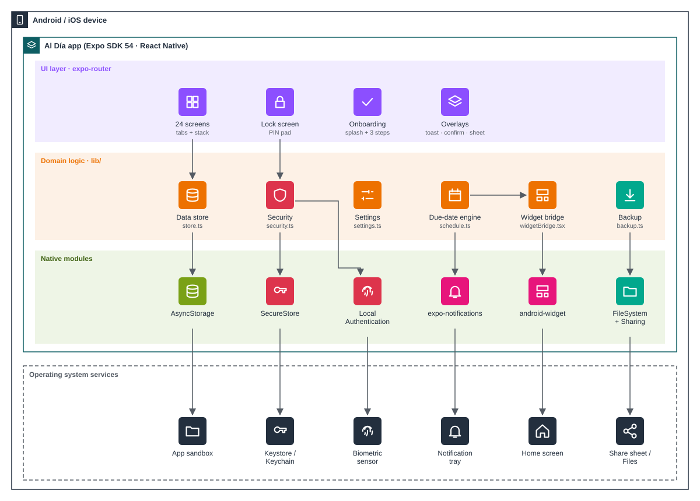
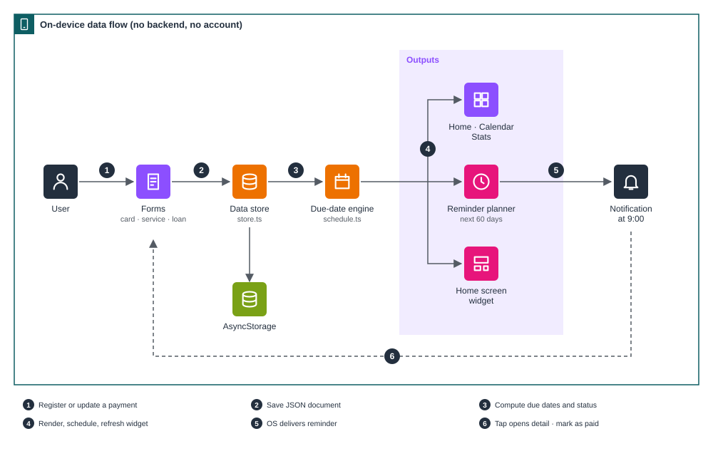

<p align="center">
  
</p>

<h1 align="center">Al Día</h1>

<p align="center">Due-date reminders for credit cards, utilities, subscriptions and loans in Peru.<br/>
Local-only data, no account, PIN or fingerprint lock.</p>

<p align="center"><b>English</b> · <a href="README.es.md">Español</a></p>

---

## Overview

| Area | Scope |
|---|---|
| Products | Credit cards, utilities (power, water, gas, internet, phone, cable, other), subscriptions, memberships, loans |
| Cards | Statement total and minimum, minimum-payment interest from TEA, membership fee waiver progress per billing cycle |
| Views | Home, Products, Calendar, Statistics, Settings, Reminders, detail and form screens (24 in total) |
| Reminders | Local notifications N days before (1, 2, 3, 5 or 7) and on the due date at 09:00; subscriptions 1 day before |
| Payments | Long-press a row in Home, Calendar or Reminders to record a payment; actual amount prompted for cards without a statement and variable bills; undo from the toast |
| Security | 4-digit PIN (salted SHA-256 in SecureStore) and biometrics; re-lock after 30 s in background; after 5 failed attempts, waits of 30 s doubling per failure; optional hiding in the recent apps view (also blocks screenshots on Android) |
| Backup | Manual JSON export and import; imported records are validated field by field |
| Widget | Android 4×2 home screen widget with the next 3 open payments and the month's pending total, light and dark variants |
| Lists | Search and sort (date, amount, name) in cards, utilities and subscriptions from 4 items; forms ask before discarding unsaved changes |
| Platforms | Android (primary), iOS |
| Currency | Soles (S/) or US dollars (US$), display only |

## Architecture



| Layer | Location | Responsibility |
|---|---|---|
| UI | `app/`, `components/` | expo-router screens, floating tab bar, global overlays (toast, confirm dialog, option sheet), lock screen, onboarding |
| Domain logic | `lib/` | Stores over AsyncStorage, due-date engine, notification planner, security, backup, widget bridge |
| Native modules | Expo SDK 54 | AsyncStorage, SecureStore, LocalAuthentication, expo-notifications, react-native-android-widget, FileSystem and Sharing |
| OS services | Android / iOS | App sandbox, Keystore/Keychain, biometric sensor, notification tray, home screen, share sheet |

Stores follow one pattern: in-memory state, listener set, `useSyncExternalStore` hook and a JSON copy in AsyncStorage. Styles are inline and read tokens from `lib/theme.ts`.

## Data flow



Due dates are never stored. `lib/schedule.ts` derives them on each render from each product's rule (due day, periodicity, installments) and the recorded payments.

| Status | Rule |
|---|---|
| Overdue | Due date before today and no payment recorded |
| Due soon | Due date today or later and no payment recorded |
| Paid | Payment recorded for that due date; subscriptions count as paid once the date has passed |
| Card without statement | Past due dates without a statement or payment are ignored (the owed amount is unknown) |
| Fee waiver | Spend accumulated until the next closing date versus the card's minimum spend |

Reminders are rebuilt 800 ms after any data or settings change and whenever the app returns to the foreground: all scheduled notifications are cancelled and the next 60 days are scheduled again (maximum 60 notifications).

## Requirements

| Tool | Version |
|---|---|
| Node.js | 22 or later |
| pnpm | 11.5.2 (`packageManager` field) |
| Expo SDK | 54 |
| EAS CLI | Included as a dev dependency (`pnpm exec eas`); requires `eas login` and `eas init` once |
| Android device or emulator | Android 7 (API 24) or later |

## Getting started

```bash
pnpm install
pnpm start          # Expo dev server
```

| Runtime | Supported features |
|---|---|
| Expo Go | All features except the home screen widget |
| Development build | All features, including the widget |

## Scripts

| Script | Command | Output |
|---|---|---|
| `start` | `expo start` | Dev server |
| `android` / `ios` | `expo run:<platform>` | Local native build and run |
| `typecheck` | `tsc --noEmit` | TypeScript check |
| `doctor` | `npx expo-doctor` | Dependency and config check |
| `build:dev` | `eas build --profile development --platform android --no-wait` | Development client APK (cloud) |
| `build:dev:ios` | `eas build --profile development --platform ios --no-wait` | Development client for iOS (cloud) |
| `build:dev:local` | same as `build:dev` with `--local` | Development client APK (local machine) |
| `build:preview` | `eas build --profile preview --platform android --no-wait` | Installable release APK (cloud) |
| `build:preview:local` | same as `build:preview` with `--local` | Installable release APK (local machine) |
| `build:prod` | `eas build --profile production --platform android --no-wait` | Store build (AAB), auto-incremented version code |
| `docs:diagrams` | `node docs/architecture/build-diagrams.js` | Regenerates the SVG diagrams in EN and ES |

## Build profiles

| Profile | Distribution | Android artifact | Use |
|---|---|---|---|
| development | internal | APK with dev client | Daily development with `pnpm start` |
| preview | internal | APK | Testing on real devices without a dev server |
| production | store | AAB | Google Play |

Local builds (`--local`) require the Android SDK and JDK 17.

## Project structure

```
app/                    expo-router routes
  (tabs)/               Home, Products (nested stack), Calendar, Statistics, Settings
  card/ service/        detail [id], form, statement (cards)
  subscription/ loan/   detail [id], form
  reminders.tsx pin.tsx
components/             ui.tsx (design kit), Icon, Logo, AppTabBar, Hosts, PinPad, LockScreen, Welcome
lib/                    store, settings, schedule, notifications, security, backup, widgetBridge, dates, format, theme
widget/                 Android widget UI and background task
docs/design/            Source screen designs
docs/architecture/      Diagrams and their generator
assets/                 Icons and splash generated from the design logo
```

## Data model

| Entity | Key fields |
|---|---|
| `CreditCard` | bank, last 4, closing day, due day, TEA, credit line, minimum spend, membership fee, statement, payments |
| `Service` | category, provider, estimate, variable amount, due day, periodicity, anchor date, actual amounts, payments |
| `Subscription` | kind (subscription or membership), category, price, periodicity, anchor date |
| `Loan` | lender, type, principal, installment, number of installments, first due date, annual rate, payments |

Payments are keyed by the due date they cover. The full document is stored under `aldia.data.v1`.

## Privacy

| Item | Storage |
|---|---|
| Products and payments | AsyncStorage, device only |
| PIN | Salted SHA-256 hash in SecureStore (Android Keystore / iOS Keychain) |
| Backup file | Created on demand in the app cache and handed to the share sheet |
| Network | Not used |
| Widget | Shows no names or amounts while the lock is enabled |

## Design

Screens follow `docs/design/Financial Manager Perú.html`: Inter, primary `#0E5E63`, floating pill tab bar, status chips (overdue, due soon, paid). The dark theme is derived from the same palette and switches without remounting navigation (`useTheme()` in each screen). The code structure mirrors the `musicdown` app (Expo Router, inline styles with theme tokens, external stores).

## License

[MIT](LICENSE)
